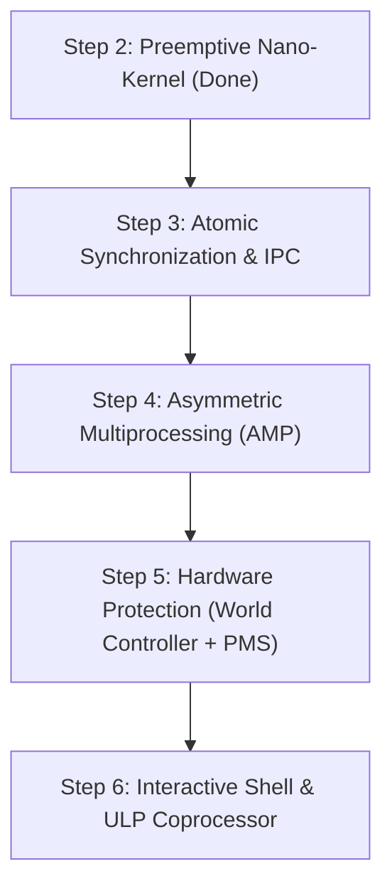

# RadixOS — Agent Execution & Implementation Guide (`AGENTS.md`)

This document serves as the operational guide and technical specification for AI agents and developers implementing **Steps 3 through 6** of RadixOS on the ESP32-S3 (Xtensa LX7 dual-core).

---

## 🧭 Project Architecture Overview

RadixOS is an evolutionary hybrid operating system written in **C99/C11** and **Xtensa LX7 Assembly**:
- **Step 1 (Done):** Bare-metal bootloader (`_start`), vector table, watchdog neutralizer, memory map (`IRAM`/`DRAM`), and UART0 polling console with `kprintf`.
- **Step 2 (Done):** Single-core preemptive nano-kernel, Call0 context switcher (`arch_context_switch`), 52-bit hardware Systimer periodic ticks, and priority-based Round-Robin scheduler.
- **Steps 3–6 (Pending):** Described in detail below.

---

## 📋 Implementation Roadmap: Steps 3 to 6

---

### 🔹 Step 3: Atomic Synchronization (`S32C1I`) & Zero-Copy IPC Channels

#### 1. Goal
Provide safe synchronization and communication primitives without relying on disable-interrupts alone, preparing for dual-core operation.

#### 2. Technical Details & Hardware Specifics
- **Atomic Primitive (`S32C1I`)**: The Xtensa LX7 core supports atomic compare-and-swap using the special register `SCOMPARE1` and the instruction `s32c1i at, as, 0`.
  - Implement `arch_atomic_cas(volatile uint32_t *addr, uint32_t compare, uint32_t set)`.
- **Spinlocks**:
  - `spinlock_t` with `ticket_lock` or simple TAS (Test-And-Set) loop.
  - IRQ-safe spinlock: `spinlock_acquire_irqsave(spinlock_t *lock, uint32_t *flags)` and `spinlock_release_irqrestore(spinlock_t *lock, uint32_t flags)`.
- **Blocking Mutex & Semaphores**:
  - `mutex_t` and `semaphore_t` integrated with scheduler wait-queues.
  - When blocked, task state changes to `TASK_STATE_BLOCKED` and triggers `sched_yield()`.
- **Zero-Copy Message Channels / Ring Buffers**:
  - Fixed-size lock-free single-producer single-consumer (SPSC) ring buffer in internal SRAM.
  - `ipc_channel_t` supporting structured message passing without dynamic memory allocation (`malloc`).

#### 3. Planned Files
- `arch/xtensa/atomic.S` (or inline assembly in `include/radix/atomic.h`)
- `include/radix/sync.h` (Spinlock, Mutex, Semaphore API)
- `include/radix/ipc.h` (Message queue and Ring Buffer structures)
- `kernel/sync.c` (Mutex and Semaphore implementation with sleep queues)
- `kernel/ipc.c` (Zero-copy IPC channel logic)
- `tests/test_sync_ipc_host.c` (Unit test suite for host validation)

---

### 🔹 Step 4: Asymmetric Multiprocessing (AMP) — Dual-Core Bring-up & Lock-Free IPIs

#### 1. Goal
Boot the secondary core (**Core 1 / APP_CPU**), establishing an Asymmetric Multiprocessing (AMP) model where Core 0 handles System/IO/Drivers and Core 1 executes User Application workloads, communicating via shared SRAM and Inter-Processor Interrupts (IPIs).

#### 2. Technical Details & Hardware Specifics
- **Core 1 Reset & Release**:
  - ESP32-S3 System control registers (`SYSTEM_CORE_1_CONTROL_0_REG` at `0x600C0000`).
  - Clear `SYSTEM_CONTROL_CORE_1_CLKEN` and `SYSTEM_CONTROL_CORE_1_RESETING`.
  - Set entry vector for Core 1 via `SYSTEM_CORE_1_BOOT_ADDR_REG`.
- **Core 1 Boot Sequence**:
  - Dedicated entry point `_start_core1` in `arch/xtensa/boot_core1.S`.
  - Separate stack space for Core 1 boot.
  - Initialize Core 1 `VECBASE` and call `kernel_core1_main()`.
- **Inter-Processor Interrupts (IPI)**:
  - Trigger interrupt on peer core using peripheral interrupt registers (`SYSTEM_CPU_INTR_FROM_CPU_X_REG`).
  - Used for scheduling reschedules, IPC notifications, and cross-core flushing.
- **Cross-Core Ring Buffer**:
  - Shared memory ring buffer in SRAM with cache-safe or non-cached memory access.

#### 3. Planned Files
- `arch/xtensa/boot_core1.S` (Core 1 boot trampoline and vector setup)
- `drivers/system.c` (ESP32-S3 Core 1 unhalt, reset release, and clock enable)
- `drivers/ipi.c` (Hardware inter-processor interrupt generation and handling)
- `include/radix/amp.h` (AMP messaging, mailbox, and core roles)
- `kernel/amp.c` (Core 1 initialization loop and cross-core dispatch)

---

### 🔹 Step 5: Hardware Protection — World Controller (`World 0` / `World 1`), PMS MPU & Syscalls

#### 1. Goal
Enforce genuine hardware memory isolation between Kernel and Tasks without a traditional MMU, leveraging the ESP32-S3's **World Controller** and **Permission Management System (PMS)**.

#### 2. Technical Details & Hardware Specifics
- **World Controller**:
  - `World 0`: Supervisor/Privileged domain (Kernel execution).
  - `World 1`: Restricted/User domain (Tasks and unprivileged services).
- **PMS (Permission Management System / MPU)**:
  - Configure SRAM regions with Read/Write/Execute (R/W/X) permissions per World.
  - Set Task stack and code segments to `World 1`, preventing direct access to kernel structures, hardware registers, and other task memories.
  - Memory access violations trigger an Access Violation Exception (`EXCCAUSE_ILLEGAL_INSTRUCTION` or `EXCCAUSE_LOAD_STORE_ERROR`), handled by the kernel to terminate offending tasks safely.
- **Syscall Gateway**:
  - User tasks execute the `syscall` Xtensa instruction to transition from `World 1` to `World 0`.
  - Vector handler decodes syscall ID in register `a2` and arguments in `a3`-`a6`.
  - Core syscalls: `sys_yield`, `sys_task_exit`, `sys_ipc_send`, `sys_ipc_recv`, `sys_get_time`, `sys_uart_write`.

#### 3. Planned Files
- `drivers/pms.c` (ESP32-S3 PMS configuration and memory region protection)
- `drivers/world.c` (World Controller switching and domain setup)
- `include/radix/syscall.h` (Syscall numbers, user-space wrappers, and signatures)
- `kernel/syscall.c` (Syscall dispatch table and validation in Kernel space)
- `arch/xtensa/syscall_handler.S` (Low-level trap entry, register saving, and return)

---

### 🔹 Step 6: Minimal Interactive Kernel Shell & RISC-V ULP Co-Processor Offloading

#### 1. Goal
Provide an interactive serial command line interface (CLI) over UART and leverage the ESP32-S3's **ULP RISC-V** coprocessor for ultra-low-power background tasks.

#### 2. Technical Details & Hardware Specifics
- **Interactive Shell (Radix-Shell)**:
  - Non-blocking line buffer reading from UART0 RX FIFO.
  - Built-in commands: `help`, `info` (uptime, CPU freq, free SRAM), `ps` (task list, state, stack usage), `kill <id>`, `amp` (core status), `reboot`.
  - VT100 ANSI terminal formatting support.
- **ULP RISC-V Coprocessor**:
  - ESP32-S3 includes a 32-bit RISC-V (RV32IMC) core in the RTC domain.
  - Load a minimal firmware image into RTC Slow Memory (`0x50000000`).
  - Configure ULP timer wakeup while main Xtensa cores are suspended in light/deep sleep.
  - Shared mailbox in RTC RAM to exchange telemetry between ULP and RadixOS kernel.

#### 3. Planned Files
- `kernel/shell.c` (Command parser, argument tokenizer, and command execution loop)
- `include/radix/shell.h` (Shell command registration macros and context)
- `ulp/ulp_main.c` / `ulp/ulp.ld` (RISC-V ULP minimal firmware program)
- `drivers/ulp.c` (ULP firmware loader, RTC clock enabler, and mailbox reader)

---

## 🛠️ Development Guidelines for Agents

1. **Git Rules**:
   - Always branch per feature: `feature/step-X-<name>`.
   - Never run `git push` automatically. Provide complete push commands for the user.
   - Use atomic Conventional Commits (`feat:`, `fix:`, `docs:`, `test:`).
2. **Coding Standards**:
   - Strict freestanding C99/C11 (`-ffreestanding -fno-builtin -nostdlib`).
   - Assembly files must use Call0 ABI conventions unless explicitly handling register windows.
   - Preserve comments and memory address constants documented in ESP32-S3 Technical Reference Manual.
3. **Build & Test Verification**:
   - Test cross-compilation with `make` (`xtensa-esp32s3-elf-gcc`).
   - Implement and verify host simulation tests with `make host-check` (`gcc` on Linux host).
