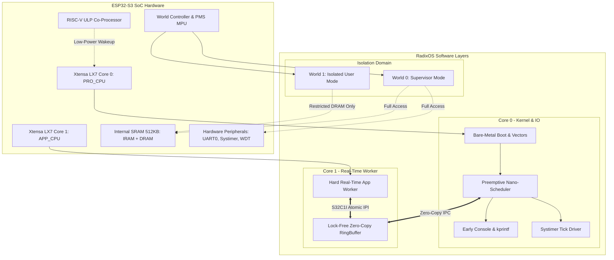

# RadixOS

> **A Minimalist, High-Performance Hybrid Operating System for the ESP32-S3 (Xtensa LX7 Dual-Core + RISC-V ULP)**

RadixOS is a lightweight, bare-metal operating system engineered from the silicon up in **C99/C11** and **Xtensa LX7 Assembly**. It bypasses heavy runtime abstractions (such as FreeRTOS or the full ESP-IDF framework) to provide deterministic execution, ultra-fast context switching, and strict hardware-enforced isolation on the Espressif ESP32-S3 SoC.

---

## 🏛️ System Architecture

RadixOS employs an **Evolutionary Hybrid Architecture** that combines:
1. **Preemptive Nano-Kernel (SASOS)**: A single address space operating system with prioritized round-robin scheduling, hardware-assisted context switching, and microsecond-level tick resolution.
2. **Asymmetric Multiprocessing (AMP)**: Core 0 (PRO_CPU) serves as the Kernel & I/O master, Core 1 (APP_CPU) is dedicated to isolated hard real-time application workloads, and the ULP (Ultra-Low Power) RISC-V co-processor performs background sensing.
3. **Silicon-Enforced Isolation**: Leveraging the ESP32-S3 **World Controller** (World 0 for Supervisor / World 1 for User tasks) and the **Permission Management System (PMS)** to grant MPU-like spatial protection over internal SRAM and memory-mapped peripherals.



---

## 🚀 Key Features

- **Direct Silicon Bootstrapping**: Zero dependencies on vendor SDK runtime initialization. Boots directly from reset vector into Xtensa assembly (`boot.S`), configures the processor state (`PS`), installs custom exception tables (`vectors.S`), zeros `.bss`, and hands off execution to `kernel_early_init()`.
- **Lightweight Xtensa Context Switch**: Tailored callee-saved register save/restore sequence taking advantage of the Xtensa LX7 register architecture, minimizing interrupt latency and context save overhead.
- **Hardware Systimer Driver**: Utilizes the 52-bit 16 MHz ESP32-S3 hardware Systimer with periodic alarm target comparisons instead of legacy timer groups.
- **Micro-Footprint `kprintf` Engine**: Formatted serial logger implemented without standard libc bloat, supporting `%s`, `%d`, `%u`, `%x`, `%p`, and `%c`.
- **Dual Validation Pipeline**:
  - **Bare-metal Cross-Compilation**: Compiles directly to Xtensa ELF and flat binary via `xtensa-esp32s3-elf-gcc`.
  - **Host Simulation & Unit Testing**: Complete host-based test harness (`make host-check`) allowing the scheduler logic, state transitions, and formatted logging to be validated on any standard Linux x86_64 host.

---

## 🗺️ Implementation Roadmap

RadixOS is engineered in 6 progressive steps:

| Step | Milestone | Status | Description |
| :---: | :--- | :---: | :--- |
| **Step 1** | **Bare-Metal Boot & Early Console** | **Implemented** | IRAM/DRAM Linker script, `boot.S`, `vectors.S`, Watchdog neutralizer, Polled UART0 driver, and `kprintf`. |
| **Step 2** | **Preemptive Nano-Kernel Scheduler** | **Implemented** | Task Control Block (TCB), Xtensa assembly context switch, 52-bit Systimer periodic tick, and round-robin scheduler. |
| **Step 3** | **Atomic Synchronization & Zero-Copy IPC** | *Planned* | Hardware atomics (`S32C1I`), spinlocks, and single-producer single-consumer lock-free ring buffers. |
| **Step 4** | **Asymmetric Multiprocessing (AMP)** | *Planned* | Bringing up Core 1 (APP_CPU), inter-processor interrupts (IPI), and memory barriers (`MEMW`). |
| **Step 5** | **Hardware Isolation & Syscalls** | *Planned* | ESP32-S3 World Controller (`World 0` vs `World 1`), PMS MPU configuration, and unprivileged user tasks. |
| **Step 6** | **Kernel Shell & RISC-V ULP Offloading** | *Planned* | Interactive serial command shell and deep-sleep offloading to the integrated RISC-V ULP co-processor. |

For deep technical architectural designs of all steps, refer to [docs/ROADMAP.md](docs/ROADMAP.md).

---

## 📂 Directory Layout

```
RadixOS/
├── Makefile                # Unified build system (cross-compilation + host-check)
├── README.md               # System overview and architecture guide
├── docs/
│   └── ROADMAP.md          # Comprehensive 6-step implementation roadmap
├── linker/
│   └── esp32s3_ram.ld      # Linker script mapping ESP32-S3 SRAM (IRAM & DRAM)
├── arch/
│   └── xtensa/
│       ├── boot.S          # Bare-metal reset vector, stack init, bss zeroing
│       ├── vectors.S       # Xtensa LX7 exception and interrupt vector table
│       ├── context_switch.S# Callee-saved context switch & first task dispatcher
│       └── include/
│           ├── xtensa_regs.h# Xtensa Special Registers (PS, VECBASE, EPC1, etc.)
│           └── esp32s3_soc.h# Real MMIO register maps (UART0, Systimer, WDT, etc.)
├── drivers/
│   ├── uart.c              # ESP32-S3 UART0 driver (FIFO polling TX/RX)
│   ├── wdt.c               # Neutralizes Timer Group 0/1, RTC, and Super WDTs
│   └── systimer.c          # 52-bit 16 MHz Systimer periodic tick generator
├── include/
│   └── radix/
│       ├── types.h         # Fixed-width types, BIT(), MMIO access macros
│       ├── kprintf.h       # Lightweight kernel formatting interface
│       ├── task.h          # TCB, CPU context structure, and task states
│       ├── sched.h         # Scheduler API (init, task_create, yield, tick)
│       └── hal.h           # Hardware abstraction layer interface
├── kernel/
│   ├── main.c              # System entry point and demonstration tasks
│   ├── kprintf.c           # Tiny, dependency-free printf implementation
│   └── sched.c             # Round-robin preemptive scheduler implementation
└── tests/
    └── test_sched_host.c   # Host test suite validating scheduler state machine
```

---

## 🛠️ Building & Testing

### 1. Prerequisites
- **Host Testing**: Any modern C compiler (`gcc` or `clang`) with `make`.
- **Target Cross-Compilation**: `xtensa-esp32s3-elf-gcc` (automatically detected in `~/.espressif/tools/` or via system `$PATH`).

### 2. Validate on Host (Instant Unit Test & Logic Verification)
You can compile and run the scheduler test suite directly on Linux:
```bash
make host-check
```
Output:
```text
Running RadixOS host simulation and scheduler tests...
[INIT] RadixOS early initialization on Host Simulation
[SCHED] Initialized scheduler with 0 active tasks
[TASK] Created task 'worker_task' (id=1, prio=2)
[TASK] Created task 'heartbeat_task' (id=2, prio=1)
[TASK] Created task 'idle_task' (id=0, prio=0)
[TEST] Scheduler state machine, round-robin yield, and tick verified successfully!
```

### 3. Build for ESP32-S3 Target
To generate the target ELF and binary:
```bash
make
```
This produces:
- `build/radixos.elf` (Xtensa LX7 ELF executable with symbol table)
- `build/radixos.bin` (Raw flat binary ready for flashing)
- `build/radixos.map` (Linker memory map)

To clean build artifacts:
```bash
make clean
```

---

## 📜 License
RadixOS is licensed under the Apache 2.0 / MIT Dual License. Developed for research and educational purposes into microkernel architecture and Xtensa LX7 bare-metal engineering.