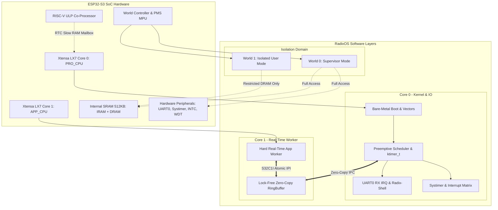

# RadixOS

> **A Minimalist, High-Performance Hybrid Operating System for the ESP32-S3 (Xtensa LX7 Dual-Core + RISC-V ULP)**

RadixOS is a lightweight, bare-metal operating system engineered from the silicon up in **C99/C11**, **Xtensa LX7 Assembly**, and **RISC-V RV32IMC**. It bypasses heavy runtime abstractions (such as FreeRTOS or the full ESP-IDF framework) to provide deterministic execution, interrupt-driven scheduling, hardware-enforced isolation, and a compact ESP32-S3 ROM-bootable image without SDK bloat.

---

## 🏛️ System Architecture

RadixOS employs an **Evolutionary Hybrid Architecture** that combines:
1. **Preemptive Nano-Kernel (SASOS)**: Priority-based round-robin scheduler with Call0 context switching, deferred ISR preemption (`sched_enter_isr` / `sched_exit_isr`), `task_sleep_ms()` / `task_sleep_ticks()`, caller-allocated `ktimer_t` software timers, and microsecond-resolution 52-bit Systimer ticks.
2. **Asymmetric Multiprocessing (AMP)**: Core 0 (`PRO_CPU`) handles kernel services, interrupt matrix routing, and interrupt-driven UART0 I/O; Core 1 (`APP_CPU`) executes isolated real-time workloads communicating via shared SRAM, `S32C1I` atomics, zero-copy SPSC channels, and hardware IPIs.
3. **Silicon-Enforced Isolation**: ESP32-S3 **World Controller** (`World 0` Supervisor / `World 1` User) and **Permission Management System (PMS)** spatial protection with `syscall` trap gateway.
4. **Interactive Radix-Shell & RISC-V ULP**: Non-blocking IRQ-backed UART0 shell (`help`, `info`, `ps`, `kill`, `amp`, `ulp`, `reboot`) and real RV32IMC firmware offloaded to RTC Slow Memory (`0x50000000`).



---

## 🗺️ Implementation Roadmap

All 6 architectural steps plus hardware interrupt routing, timers, and flashable build tooling are implemented:

| Step | Milestone | Status | Description |
| :---: | :--- | :---: | :--- |
| **Step 1** | **Bare-Metal Boot & Early Console** | **Implemented** | IRAM/DRAM Linker script, `boot.S`, `vectors.S`, Watchdog neutralizer, UART0 driver, and `kprintf`. |
| **Step 2** | **Preemptive Nano-Kernel Scheduler** | **Implemented** | TCB, Xtensa Call0 context switch, 52-bit Systimer tick, Interrupt Matrix (`intc`), timed sleep & `ktimer_t`. |
| **Step 3** | **Atomic Synchronization & Zero-Copy IPC** | **Implemented** | Hardware atomics (`S32C1I`), IRQ-safe spinlocks, blocking mutexes/semaphores, and SPSC lock-free ring buffers. |
| **Step 4** | **Asymmetric Multiprocessing (AMP)** | **Implemented** | Core 1 (`APP_CPU`) bring-up (`boot_core1.S`), hardware IPIs, cross-core RPC, and `MEMW` barriers. |
| **Step 5** | **Hardware Isolation & Syscalls** | **Implemented** | ESP32-S3 World Controller (`World 0` / `World 1`), PMS MPU regions, and `syscall` trap dispatcher. |
| **Step 6** | **Kernel Shell & RISC-V ULP Offloading** | **Implemented** | Interrupt-driven UART0 RX shell (`Radix-Shell`), real RV32IMC ULP firmware build, and ESP32-S3 flashable image generator. |

For detailed register-level architecture and verification notes, refer to [docs/ROADMAP.md](docs/ROADMAP.md).

---

## 📂 Directory Layout

```
RadixOS/
├── Makefile                    # Unified build system (target, ULP RV32IMC, host-check, flash, qemu)
├── README.md                   # System overview and build guide
├── AGENTS.md                   # Agent execution guide and ESP32-S3 specs
├── docs/
│   └── ROADMAP.md              # 6-step architectural roadmap and verification strategy
├── linker/
│   └── esp32s3_ram.ld          # Linker script mapping ESP32-S3 SRAM (IRAM & DRAM)
├── arch/xtensa/
│   ├── atomic.S                # S32C1I atomic compare-and-swap primitives
│   ├── boot.S                  # Core 0 bare-metal reset vector, stack, VECBASE, .bss zeroing
│   ├── boot_core1.S            # Core 1 (APP_CPU) boot trampoline
│   ├── context_switch.S        # Call0 callee-saved context switch & task launcher
│   ├── syscall_handler.S       # Low-level syscall trap entry/exit
│   ├── vectors.S               # Xtensa LX7 exception & Level 1 interrupt vectors
│   └── include/
│       ├── esp32s3_soc.h       # ESP32-S3 TRM MMIO registers (UART, Systimer, INTC, WCL, RTC/ULP)
│       └── xtensa_regs.h       # Xtensa Special Registers (PS, VECBASE, INTENABLE, etc.)
├── drivers/
│   ├── intc.c                  # ESP32-S3 Interrupt Matrix driver
│   ├── ipi.c                   # Inter-Processor Interrupts (CPU_INTR_FROM_CPU_0/1)
│   ├── pms.c                   # Permission Management System (SRAM MPU)
│   ├── system.c                # Core 1 reset/clock control
│   ├── systimer.c              # 52-bit 16 MHz Systimer periodic tick driver
│   ├── uart.c                  # UART0 driver (TX polling + RX IRQ ring buffer)
│   ├── ulp.c                   # RISC-V ULP RTC COCPU driver & shared mailbox
│   ├── wdt.c                   # TIMG0/1, RTC, and Super WDT neutralizer
│   └── world.c                 # World Controller (World 0 <-> World 1)
├── include/radix/              # Kernel headers (amp, atomic, hal, intc, ipc, kprintf, pms, sched, shell, sync, syscall, task, timer, types, uart, ulp)
├── kernel/
│   ├── amp.c                   # Dual-core AMP initialization and remote call dispatch
│   ├── ipc.c                   # Zero-copy SPSC IPC channels
│   ├── kprintf.c               # Freestanding formatted console logger
│   ├── main.c                  # Early init, IRQ routing, and kernel workloads
│   ├── sched.c                 # Priority round-robin scheduler, deferred ISR preemption & sleep
│   ├── shell.c                 # Radix-Shell CLI (help, info, ps, kill, amp, ulp, reboot)
│   ├── sync.c                  # Spinlocks, mutexes, and semaphores
│   ├── syscall.c               # Syscall table and World 1->0 dispatch
│   └── timer.c                 # Caller-allocated software timers (ktimer_t)
├── ulp/
│   ├── ulp_main.c              # RV32IMC ULP coprocessor firmware (RTC Slow RAM)
│   └── ulp.ld                  # ULP linker script (0x50000000..0x50001EFF + mailbox at 0x50001F00)
├── tools/
│   ├── mk_esp32s3_image.py     # ESP32-S3 ROM image generator/verifier & 4 MB flash image builder
│   └── bin2c.py                # Converts compiled ulp_main.bin into build/ulp_fw_bin.h
└── tests/
    ├── test_sched_host.c       # Step 1 & 2 scheduler & kprintf host tests
    ├── test_sync_ipc_host.c    # Step 3 atomics, spinlocks, mutex, sem & IPC host tests
    ├── test_amp_host.c         # Step 4 AMP & IPI host tests
    ├── test_pms_syscall_host.c # Step 5 World Controller, PMS & syscalls host tests
    ├── test_shell_ulp_host.c   # Step 6 Radix-Shell & ULP host tests
    ├── test_intc_host.c        # Interrupt Matrix & deferred ISR preemption host tests
    ├── test_timers_uart_host.c # Timed sleep, ktimer_t & UART0 RX IRQ host tests
    └── test_build_ulp_host.c   # ULP bounds/state machine & ESP32-S3 image verification tests
```

---

## 🛠️ Building, Flashing & Testing

### 1. Prerequisites
- **Host Testing**: `gcc` (or `clang`), `make`, and `python3`.
- **Target Cross-Compilation**: `xtensa-esp32s3-elf-gcc` (auto-detected in `~/.espressif/tools/` or `$PATH`).
- **ULP RISC-V Compilation (optional)**: `riscv32-esp-elf-gcc`, `riscv32-unknown-elf-gcc`, or `riscv64-unknown-elf-gcc` (auto-detected in `~/.espressif/tools/` or `$PATH`). If absent, the build emits an informational notice and embeds a documented RV32IMC fallback array.
- **Flashing & Emulation (optional)**: `esptool` / `esptool.py` and Espressif `qemu-system-xtensa`.

### 2. Build ESP32-S3 Target & Flashable ROM Image
```bash
make
```
Produces:
- `build/radixos.elf` — Xtensa LX7 ELF32 executable.
- `build/radixos.bin` — Compact ESP32-S3 ROM bootloader image (~20 KB, generated by `tools/mk_esp32s3_image.py` directly from `PT_LOAD` segments without the ~7 MB DRAM-to-IRAM `objcopy` gap), complete with 24-byte ESP32-S3 extended header (`chip_id = 0x0009`), segment headers, XOR checksum, and SHA-256 digest.
- `build/ulp_main.elf`, `build/ulp_main.bin`, `build/ulp_fw_bin.h` — Real RV32IMC ULP firmware compiled from `ulp/ulp_main.c` + `ulp/ulp.ld` (when a RISC-V GCC toolchain is present).
- `build/radixos.map` — Linker memory map.

Verify an image standalone:
```bash
python3 tools/mk_esp32s3_image.py --verify build/radixos.bin
```

### 3. Validate All Subsystems on Host (`make host-check`)
Compiles and executes all 8 host simulation suites, validates `build/radixos.bin` (< 256 KB, valid header/checksum/SHA-256), and verifies that `ulp_simulate_wakeup_cycle` is strictly absent from `build/radixos.elf`:
```bash
make host-check
```

### 4. Generate Raw Flash Image, Run QEMU, or Flash Hardware
Create a 4 MB `0xFF`-padded SPI flash image (`build/radixos_flash.bin` with `radixos.bin` at offset `0x0000`):
```bash
make flash-image
```
Run in Espressif QEMU (`qemu-system-xtensa`, if installed):
```bash
make qemu
```
Flash to an ESP32-S3 board via `esptool`:
```bash
make flash ESP32S3_PORT=/dev/ttyUSB0 ESP32S3_BAUD=460800
```
Clean all build artifacts:
```bash
make clean
```

---

## 📜 License
RadixOS is licensed under the Apache 2.0 / MIT Dual License. Developed for research and educational purposes into microkernel architecture and Xtensa LX7 bare-metal engineering.
